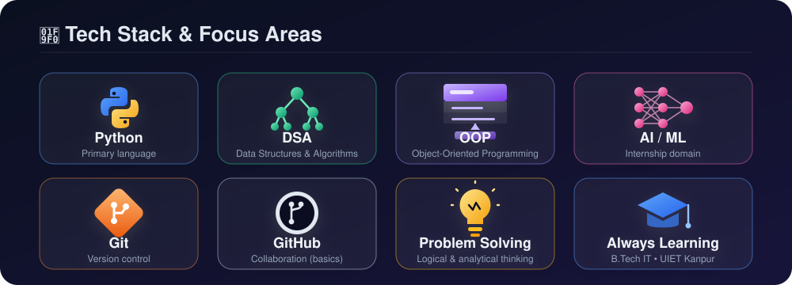
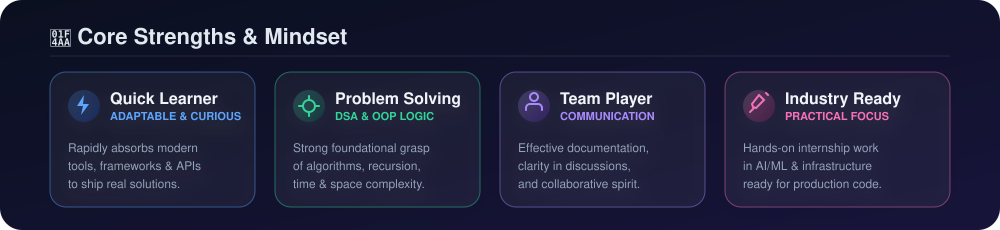
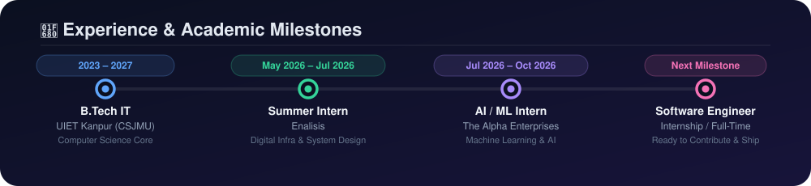

<div align="center">



<a href="https://git.io/typing-svg"></a>

<p>
  
  
  
</p>

<a href="mailto:anu043116@gmail.com"></a>


</div>


## 👋 About Me

Motivated **B.Tech Information Technology** student at **UIET, Kanpur (CSJMU)**, graduating in **2027**. I enjoy **Python**, **Data Structures & Algorithms** and analytical problem solving, and I pick up new technologies quickly. I'm looking for an internship or entry-level **Software Engineer** role where I can build real things and grow through real-world experience.

```python
class Abhay:
    role       = "B.Tech IT Student"
    college    = "UIET Kanpur (CSJMU)"
    graduating = 2027
    focus      = ["Python", "DSA", "AI/ML", "Problem Solving"]
    mindset    = "Industry-ready, always learning"

    def current_goal(self):
        return "Land a Software Engineer role and ship impactful projects"
```


## 🧰 Tech Stack

<div align="center">



<br/><br/>

<a href="https://www.python.org/"></a>

<br/>


</div>

<!--
  Want more icons later? Add only what you actually use, e.g.:
  https://skillicons.dev/icons?i=python,git,github,vscode,linux,jupyter
  Full icon list: https://github.com/tandpfun/skill-icons#icons-list
-->


## 💪 Skills & Strengths




## 🚀 Journey



### 💼 Experience

| Role | Organization | Period | Domain |
|------|--------------|--------|--------|
| 🧪 Summer Intern | **Enalisis** | 21 May 2026 – 2 Jul 2026 | Digital Infrastructure & System Design |
| 🤖 AI/ML Intern | **The Alpha Enterprises**, Lucknow | 1 Jul 2026 – 31 Oct 2026 | Artificial Intelligence & Machine Learning |

### 🎓 Education

**B.Tech in Information Technology**: University Institute of Engineering & Technology (UIET), Kanpur, affiliated to CSJMU. Expected graduation: **2027**.


## 📊 GitHub Stats

<div align="center">


</div>


## 🤝 Let's Connect

I'm open to internships, entry-level software roles and collaboration on Python and AI/ML projects.

<div align="center">

<a href="mailto:anu043116@gmail.com"></a>

<br/><br/>


</div>
